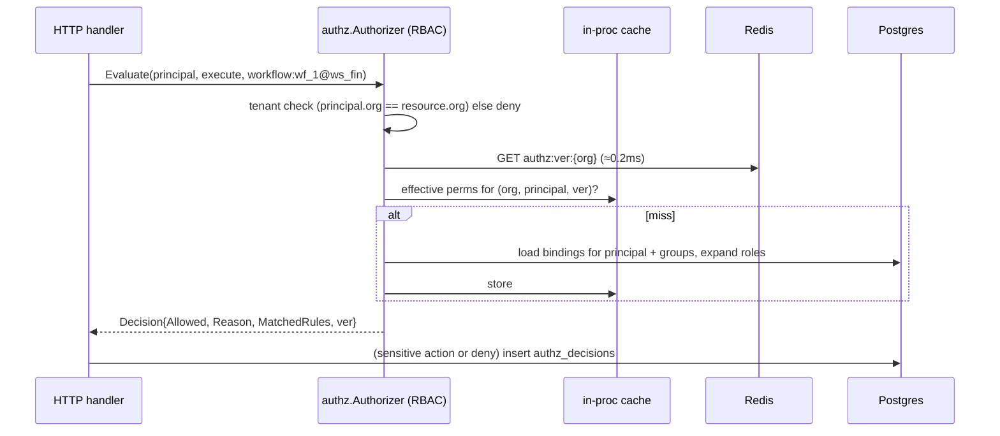

# Authorization Architecture

## 1. Contract (stable across all phases)

```go
package authz

type Authorizer interface {
    Evaluate(ctx context.Context, in AuthorizationInput) (AuthorizationDecision, error)
}

type AuthorizationInput struct {
    Principal Principal          // who
    Action    string             // e.g. "execute"
    Resource  Resource           // what
    Context   map[string]any     // request context: ip, env, time (used by ABAC in Phase 3)
}

type Principal struct {
    ID, Type   string            // Type: user | service_account
    OrgID      uuid.UUID
    Groups     []uuid.UUID
    Attributes map[string]any    // department, idp claims (Phase 3 ABAC)
}

type Resource struct {
    Type        string           // registered resource type, e.g. "workflow"
    ID          string           // "" for collection-level actions (create, list)
    OrgID       uuid.UUID
    WorkspaceID *uuid.UUID
    Attributes  map[string]any   // classification, owner, environment
}

type AuthorizationDecision struct {
    Allowed       bool
    Reason        string         // machine code: "granted_by_binding", "no_matching_binding", "tenant_mismatch"
    MatchedRules  []string       // binding/policy ids — for audit & simulation UI
    PolicyVersion int64          // org authz version used
}
```

Plus a list-filtering companion, because evaluating per row does not scale for list endpoints:

```go
type ScopeResolver interface {
    // Returns the set of scopes (org-wide, workspace ids, resource ids) in which the principal holds `perm`.
    AccessibleScopes(ctx context.Context, p Principal, resourceType, action string) (Scopes, error)
}
```

Repositories turn `Scopes` into a SQL predicate (`workspace_id = ANY($1) OR id = ANY($2)`).

## 1a. Status

Implemented in S3 (`internal/authz`): `RBAC` (Authorizer + ScopeResolver), `Service` (roles, bindings,
simulation, effective permissions), version-stamped grant cache, decision log. The S1–S2 `InterimAuthorizer`
and `org_memberships.is_owner` were removed by migration `00006_rbac` (owners → `org_owner` binding;
workspace members → workspace-scope bindings: creator `workspace_admin`, others `editor`).

**Workspace membership = holding any workspace-scope binding** in that workspace (one source of truth; per-
workspace roles). The organization domain reads it through the `workspace_access` and `org_member_roles` views
(`security_invoker`, so RLS applies) instead of authz's tables.

**Baseline access:** every member receives the `member` role at org scope (organization/department/environment/
subscription read). It is an ordinary editable role, not hidden logic.

**No escalation (`CanGrant`):** creating or widening a role, or assigning one, requires the caller to hold every
permission involved at the target scope (wildcards included: only `*:*` covers `*:*`). The last `org_owner`
binding cannot be removed. Creators of a workspace become its `workspace_admin` automatically.

**Cache:** grants are cached per (org, user) keyed by `organizations.authz_version`. Every role/binding change
bumps the version in the same transaction and, after commit, drops the Redis stamp `authz:ver:{org}` and local
entries; other instances re-read the version on their next request. Without Redis the version is read from
Postgres; cached grants are never trusted longer than 30s (`MaxStaleness`).

## 1b. Interim implementation (S1–S2, removed)

Until S3 lands, `authz.InterimAuthorizer` implements the same contract, deny-by-default:
tenant mismatch → deny (rendered as 404); organization owner → allow; other members → only an explicit allowlist
(`organization:read`); everything else denied. Every handler already calls `authz.Require`, so S3 swaps the
implementation without touching domain code. Decision auditing to `authz_decisions` arrives with S3.

## 2. Phase 1 model — dynamic RBAC

- **Resource types** are registered at boot by each domain (code declares *what exists*; upserted into
  `resource_types` with their allowed actions). Permissions are therefore data: `workflow:execute`, `dataset:export`.
  Adding a new resource type in Phase 2/3 is one registration call — no schema change, no role code.
- **Roles** are org-owned rows with a set of permissions. On org creation, templates are copied in
  (`org_owner`, `org_admin`, `workspace_admin`, `editor`, `operator`, `viewer`). Only `org_owner` is immutable.
- **Role bindings**: `(principal: user|group|service_account) × role × scope`, where scope is one of
  `org`, `workspace:<id>`, `resource:<type>:<id>`.
- **Evaluation**: deny by default. Allow iff `principal.org == resource.org` **and** some binding for the principal or
  one of its groups grants `type:action` at a scope that contains the resource (org ⊃ workspace ⊃ resource).
- **Wildcards**: `workflow:*` and `*:read` supported in role definitions; `*:*` only in `org_owner`.

The PRD's example `finance_analyst` maps to:
role `finance_analyst` = {`dataset:read`,`dataset:query`,`dataset:export`,`workflow:read`,`workflow:execute`}
bound at `resource:dataset:finance.payments` and `resource:workflow:finance.reconciliation` (or at the Finance workspace).



## 3. Cache correctness

- Every write to roles, role_permissions, role_bindings, group_members or workspace_members increments
  `organizations.authz_version` in the same tx and (post-commit) `SET authz:ver:{org}` in Redis.
- The in-process cache key includes the version, so a bump invalidates instantly cluster-wide.
- If Redis is unreachable, the cache entry TTL caps staleness at **30s** and the version is read from Postgres.
  Satisfies "never rely on stale authorization cache indefinitely".
- Session revocation and user deactivation bypass the cache (checked on session load).

## 4. Auditing

`authz_decisions` records every **deny** and every **allow for sensitive actions** (flagged on the resource type's
action: e.g. `secret:use`, `workflow:execute`, `role:*`, `dataset:export`). Normal reads are not recorded (volume),
but are traceable via request logs. Ships to ClickHouse in Phase 2 for retention/analysis.

## 5. Evolution path (Phase 3)

The `Authorizer` stays; implementations compose:

```
CompositeAuthorizer
  ├─ TenantGuard (always first, non-bypassable)
  ├─ RBACAuthorizer (Phase 1)
  ├─ PolicyAuthorizer (ABAC — CEL conditions over principal/resource/context, deny-overrides)
  ├─ RelationshipAuthorizer (ReBAC — native tuples or OpenFGA adapter)
  └─ ExternalAuthorizer adapters (OPA, Cedar, Casbin, HTTP)
```

The PRD's YAML policy example maps directly to a policy document whose `conditions` are compiled CEL
(see [ADR-0010](../adr/0010-expression-language-cel.md)) — schema-validated, non-Turing-complete, cost-bounded.
Field-level and row-level restrictions are expressed as **obligations** returned on the decision (Phase 2/3), applied by
the query layer, not by the UI.

## 6. Frontend

`GET /v1/hugimethara/me/permissions?workspace_id=…` returns effective permission strings so the UI can hide or disable
controls. The UI never *enforces*; every endpoint re-evaluates server-side.
