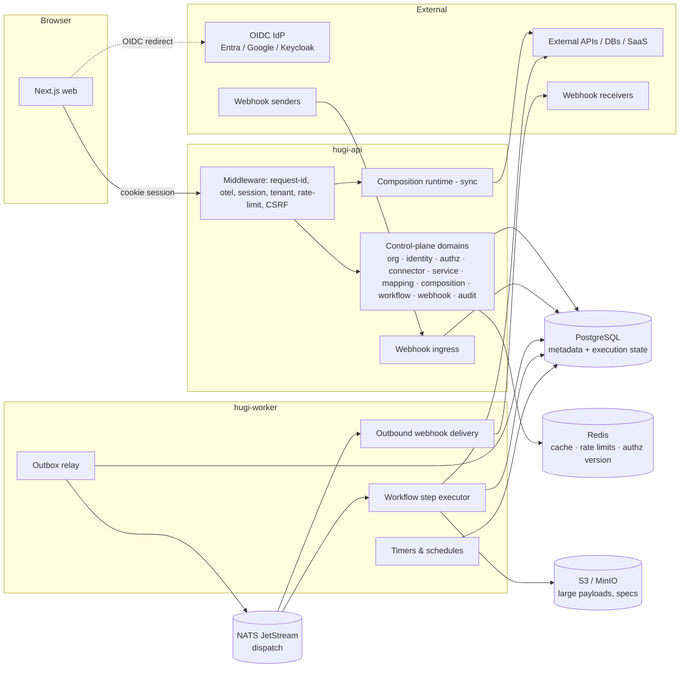

# System Overview

## 1. Shape of the system

Hugimethara is a **modular monolith** (see [ADR-0001](../adr/0001-modular-monolith.md)) written in Go, deployed as
a small number of independently scalable **binaries built from one codebase**:

| Binary | Plane | Responsibility | Scales on |
|---|---|---|---|
| `hugi-api` | Control + sync data plane | REST API, auth/session, config CRUD, synchronous API-composition execution, inbound webhook ingress | HTTP RPS |
| `hugi-worker` | Data plane | Workflow step execution, connector calls, outbound webhook delivery, outbox relay, timers/schedules | Queue depth |
| `hugi-migrate` | Ops | Database migrations + seed | One-shot |
| `web` (Next.js) | UI | Browser application | HTTP RPS |

The Control Plane writes configuration to PostgreSQL. The Data Plane reads **immutable, versioned snapshots** of that
configuration (published workflow versions, composition versions, connector instance configs) and caches them, so
execution never round-trips to "the control plane service" per request — it reads Postgres/cache directly through
the owning domain's service interface. That is how §4.2's "control plane must not be a bottleneck" is met without a
network hop between planes.

## 2. Component diagram



ClickHouse joins in Phase 2 (analytics), see [data-architecture.md](data-architecture.md).

## 3. Repository layout

```
hugimethara/
├── api/openapi/                 # OpenAPI 3.0.3 spec, split per domain, bundled in CI
├── cmd/                         # api, worker, migrate, and admin binaries
├── internal/
│   ├── bootstrap/               # process composition roots
│   ├── modules/                 # identity, organization, authorization, integrations, governance, workflow
│   ├── platform/                # config, database, HTTP middleware, telemetry, crypto, messaging, cache
│   └── transport/http/          # routes, handlers, and generated strict server
├── migrations/postgres/         # embedded goose migrations
├── apps/web/
│   └── src/
│       ├── app/                 # Next.js routes: (auth)/…, (app)/[org]/[workspace]/…
│       ├── features/<feature>/  # api hooks, components, zod schemas per feature
│       ├── components/ui/       # shadcn/ui primitives
│       └── lib/                 # generated API client, auth, permission helpers
├── deployments/compose/         # Docker Compose and local dev assets
└── docs/
```

Implemented domain packages are grouped by bounded context under `internal/modules`. Several existing modules
still keep service logic, sqlx persistence helpers, embedded SQL, and HTTP adapters in one Go package; those
boundaries can be extracted incrementally without changing the domain-level import paths.

```
internal/modules/identity/
  service.go    # identity use cases
  queries.sql   # plain, named SQL statements (embedded; ADR-0012)
  authstore.go  # sqlx persistence helpers
  http*.go      # transport adapters
```

Dependency rules are in [domain-boundaries.md](domain-boundaries.md) and are enforced with `depguard`/`go-arch-lint` in CI.

## 4. Request path (synchronous API call)

```mermaid
sequenceDiagram
  participant B as Browser
  participant A as hugi-api
  participant R as Redis
  participant P as PostgreSQL
  B->>A: POST /v1/hugimethara/workflows/{id}/execute (cookie, X-CSRF-Token)
  A->>A: request-id, trace span, rate limit
  A->>R: session lookup (fallback PG)
  A->>A: resolve principal {user, org, groups}
  A->>P: BEGIN; SET LOCAL app.org_id = …   (RLS)
  A->>A: authz.Evaluate(principal, workflow:execute, resource)
  A->>P: insert execution + outbox row; COMMIT
  A-->>B: 202 {execution_id}
  Note over A,P: audit event written in the same transaction
```

## 5. Cross-cutting concerns

| Concern | Approach | Doc |
|---|---|---|
| Tenancy | `org_id` on every tenant row, composite FKs, Postgres RLS as defense-in-depth | [ADR-0002](../adr/0002-postgresql-tenancy.md) |
| AuthN | Server-side sessions (opaque cookie), local + OIDC login, API keys for service accounts | [ADR-0006](../adr/0006-identity-federation.md) |
| AuthZ | Single `Authorizer` contract, native RBAC in Phase 1 | [authorization-architecture.md](authorization-architecture.md) |
| Secrets | Envelope encryption (AES-256-GCM), KEK from env/KMS | [security model](../security/security-model.md) |
| Egress | All outbound HTTP/DB through `platform/egress` with SSRF guard + per-env allowlist | [integration-architecture.md](integration-architecture.md) |
| Expressions | CEL (sandboxed, cost-limited) for conditions & advanced mapping | [ADR-0010](../adr/0010-expression-language-cel.md) |
| Observability | OpenTelemetry traces/metrics, `slog` JSON logs, Prometheus scrape | [operations](../operations/observability.md) |
| Contracts | OpenAPI-first; Go server stubs via oapi-codegen (chi), TS client via openapi-typescript | [ADR-0009](../adr/0009-frontend-architecture.md) |
