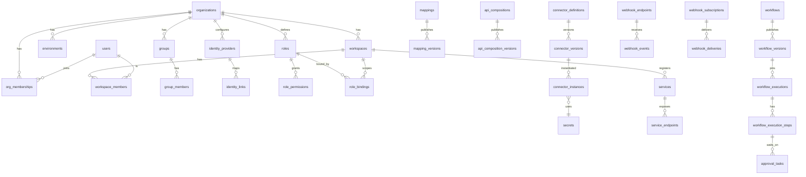

# Phase 1 Database Design (PostgreSQL)

Conventions ([ADR-0002](../adr/0002-postgresql-tenancy.md)):
- `id uuid PRIMARY KEY DEFAULT uuidv7()` (PostgreSQL 18 built-in; Go also generates UUIDv7). Tenant tables: `org_id uuid NOT NULL`, `UNIQUE (org_id, id)`,
  composite FKs `(org_id, x_id)`, RLS on.
- `created_at`, `updated_at timestamptz NOT NULL DEFAULT now()`; `created_by uuid` where authorship matters.
- Soft-delete only where history must be kept (`archived_at`); otherwise hard delete + audit event.
- Enums as `text` + `CHECK` (easier to evolve than PG enums).
- Slugs: `citext`, unique within parent scope.
- JSONB only for: connector config/schemas, definitions (mapping/composition/workflow), step I/O, policy-like docs,
  settings. Every JSONB column has a JSON Schema validated in Go before write.

## 1. Entity groups

### Organization
| Table | Key columns / constraints |
|---|---|
| organizations | id, slug (unique), name, status(`active`/`suspended`), plan, authz_version bigint, settings jsonb |
| departments | org_id, id, name, slug — UNIQUE(org_id, slug) |
| workspaces | org_id, id, slug, name, department_id?, description, archived_at — UNIQUE(org_id, slug) |
| workspace_members | org_id, workspace_id, user_id — PK(workspace_id, user_id) |
| environments | org_id, id, slug(`development`/`staging`/`production`/custom), is_production, egress_allowlist jsonb |

### Identity
| Table | Key columns / constraints |
|---|---|
| users | id, email citext (global unique), display_name, status(`active`/`invited`/`disabled`) |
| org_memberships | org_id, user_id, status, joined_at — PK(org_id, user_id) |
| user_credentials | user_id, password_hash (argon2id), mfa_secret_enc?, failed_attempts, locked_until |
| sessions | id, token_hash (unique), user_id, org_id, created_at, last_seen_at, expires_at, revoked_at, ip, user_agent |
| identity_providers | org_id, id, protocol(`oidc`; `saml` reserved), preset(`entra`/`google`/`keycloak`/`generic`), issuer, client_id, client_secret_ref → secrets, scopes[], claim_mapping jsonb, jit_provisioning bool, allowed_domains[], enabled |
| identity_links | org_id, idp_id, subject, user_id — UNIQUE(idp_id, subject) |
| groups | org_id, id, name, source(`internal`/`idp`) — UNIQUE(org_id, name) |
| group_members | org_id, group_id, user_id |
| group_mappings | org_id, idp_id, external_group, group_id |
| invitations | org_id, id, email, token_hash, workspace_ids[], role_id?, expires_at, accepted_at, invited_by |
| service_accounts | org_id, id, name, workspace_id?, disabled_at |
| api_keys | org_id, id, service_account_id, prefix (unique), key_hash, expires_at, last_used_at, revoked_at |

### Authorization
| Table | Key columns / constraints |
|---|---|
| resource_types | type (PK, global), actions text[], sensitive_actions text[], scope_kinds text[] — registered at boot |
| roles | org_id, id, key, name, description, is_system, immutable — UNIQUE(org_id, key) |
| role_permissions | org_id, role_id, permission text (`workflow:execute`, `workflow:*`) — PK(role_id, permission) |
| role_bindings | org_id, id, principal_type(`user`/`group`/`service_account`), principal_id, role_id, scope_type(`org`/`workspace`/`resource`), scope_workspace_id?, scope_resource_type?, scope_resource_id?, expires_at? — CHECK scope columns consistent; partial unique indexes per scope |
| authz_decisions | org_id, id, at, principal, action, resource_type, resource_id, allowed, reason, matched_rules[], authz_version, request_id |

(`principals`, `policies`, `policy_sets`, `policy_bindings` from PRD §9 are Phase 3.)

### Audit & events
| Table | Key columns |
|---|---|
| audit_events | org_id, id, at, actor_type, actor_id, action (`workflow.published`), resource_type, resource_id, workspace_id?, request_id, ip, changes jsonb (redacted diff), outcome |
| outbox | id bigint identity, org_id, subject, payload jsonb, headers jsonb, created_at, sent_at?, attempts — partial index WHERE sent_at IS NULL |

`audit_events` is append-only: `hugi_app` has INSERT/SELECT only. Monthly range partitions on `at`.

### Secrets
| Table | Key columns |
|---|---|
| data_keys | org_id, id, kek_id, wrapped_key bytea, created_at, retired_at |
| secrets | org_id, id, environment_id?, kind, name, dek_id, nonce, ciphertext bytea, hint, version, rotated_at |

### Connector & Service registry
| Table | Key columns |
|---|---|
| connector_definitions | id, org_id? (NULL = global catalog), key, name, category, tier(`builtin`/`declarative`/`custom`), icon |
| connector_versions | id, definition_id, version (semver), config_schema jsonb, auth_methods jsonb, operations jsonb, spec jsonb (declarative), deprecated_at — UNIQUE(definition_id, version) |
| connector_instances | org_id, id, workspace_id, environment_id, ref_key, connector_version_id, config jsonb, auth_method, secret_id, rate_limit, timeout_ms, retry_policy jsonb, status — UNIQUE(org_id, workspace_id, environment_id, ref_key) |
| connector_health | org_id, instance_id, checked_at, ok, latency_ms, error_code, message |
| services | org_id, id, workspace_id, name, owner, description, protocol(`rest`/`graphql`/`grpc`) |
| service_environments | org_id, service_id, environment_id, base_url, connector_instance_id (auth) |
| service_specs | org_id, id, service_id, format, version_label, object_key, sha256, imported_at |
| service_endpoints | org_id, id, service_id, spec_id, operation_id, method, path, summary, parameters jsonb, request_schema jsonb, response_schemas jsonb, security jsonb, deprecated — UNIQUE(service_id, method, path) |

### Mapping & Composition
| Table | Key columns |
|---|---|
| mappings | org_id, id, workspace_id, name, draft jsonb, input_schema jsonb?, output_schema jsonb? |
| mapping_versions | org_id, id, mapping_id, version int, definition jsonb, checksum, published_by — UNIQUE(mapping_id, version) |
| mapping_tests | org_id, id, mapping_id, name, input jsonb, expected jsonb |
| api_compositions | org_id, id, workspace_id, name, slug, draft jsonb, exposed bool |
| api_composition_versions | org_id, id, composition_id, version, definition jsonb, checksum |
| api_composition_executions | org_id, id, version_id, environment_id, started_at, duration_ms, status, step_summary jsonb, error, request_id (30-day retention) |

### Workflow
| Table | Key columns |
|---|---|
| workflows | org_id, id, workspace_id, name, description, draft jsonb, status(`draft`/`active`/`paused`/`archived`) |
| workflow_versions | org_id, id, workflow_id, version, definition jsonb, checksum, published_by, published_at |
| workflow_deployments | org_id, workflow_id, environment_id, version_id, enabled — PK(workflow_id, environment_id) |
| workflow_triggers | org_id, id, workflow_id, environment_id, type, config jsonb, next_fire_at? (schedule), webhook_endpoint_id? |
| workflow_executions | org_id, id, workflow_id, version_id, environment_id, trigger_type, trigger_ref, idempotency_key?, status, input_ref, output_ref, error jsonb, started_at, finished_at, deadline_at, step_count — UNIQUE(workflow_id, idempotency_key) |
| workflow_execution_steps | org_id, id, execution_id, node_id, iteration_path text, attempt, status, lease_until, worker_id, input jsonb/ref, output jsonb/ref, port, error jsonb, queued_at, started_at, finished_at — index (status, lease_until) |
| workflow_timers | org_id, id, execution_id, step_id, kind(`delay`/`retry`/`approval_timeout`/`execution_deadline`), fire_at, fired_at — partial index on fire_at WHERE fired_at IS NULL |
| approval_tasks | org_id, id, execution_id, step_id, kind(`approval`/`input`), assignee_rule jsonb, form_schema jsonb?, status, decided_by, decided_at, decision jsonb, comment |

### Webhook
| Table | Key columns |
|---|---|
| webhook_endpoints | org_id, id, workspace_id, environment_id, public_id (unique, random), name, verifier jsonb (scheme + secret_id), rate_limit, filter (CEL), enabled |
| webhook_events | org_id, id, endpoint_id, provider_event_id?, received_at, headers jsonb (redacted), payload jsonb / object_key, signature_valid — UNIQUE(endpoint_id, provider_event_id) |
| webhook_subscriptions | org_id, id, workspace_id, url, event_types[], filter, secret_id, enabled, disabled_reason |
| webhook_deliveries | org_id, id, subscription_id, event_id, replay_of?, attempt, status(`pending`/`succeeded`/`failed`/`dead_lettered`), next_attempt_at, response_status, response_excerpt, latency_ms |

### S1 implementation notes
- `users` and `user_credentials` are **global** (one person, many orgs). `hugi_app` sees a user only if they are a member
  of the current org. Login and session resolution happen before a tenant is known, so they go through four
  `SECURITY DEFINER` functions owned by the `hugi_auth` role: `hugi_auth_login_lookup`, `hugi_auth_user_orgs`,
  `hugi_auth_record_attempt`, `hugi_auth_resolve_session`. They return only what authentication needs.
- `org_memberships.is_owner` is interim until S3; S3 migrates owners to `org_owner` role bindings.
- `sessions` stores SHA-256 of the session token and of the CSRF token, never the tokens.
- `audit_events` is append-only for `hugi_app` (INSERT/SELECT). Partitioning by month is deferred until volume
  justifies it (tracked in the backlog).

## 2. ERD (core relationships)

## 3. Migration plan (Phase 1 slices)

| Migration | Slice |
|---|---|
| ✅ 00001_platform_foundation (citext, pgcrypto, `hugi_app`/`hugi_system` roles + grants, `hugi_current_org()` RLS helper, `hugi_touch_updated_at()`) | S0 |
| ✅ 00002_outbox (moved forward from S1: the relay is platform infrastructure every later slice uses) | S0 |
| ✅ 00003_org_identity_audit (organizations, users, org_memberships, user_credentials, sessions, audit_events, `hugi_auth` role + pre-tenant auth functions) | S1 |
| ✅ 00004_workspaces (departments, environments + backfill, workspaces, workspace_members; composite FKs) | S2 |
| ✅ 00005_entitlements (features, plans, plan_entitlements, org_subscriptions, org_entitlement_overrides + seed) | S2 (paid features, ADR-0013) |
| ✅ 00006_rbac (resource_types, role_templates, roles, role_permissions, role_bindings, authz_decisions, views workspace_access / org_member_roles; backfill; drops workspace_members and is_owner) | S3 |
| 0006_groups_invitations_service_accounts | S4 |
| 0007_identity_providers | S5 |
| 0008_secrets_connectors | S6 |
| 0009_service_registry | S7 |
| 0010_mappings · 0011_compositions | S8–S9 |
| 0012_workflows · 0013_workflow_timers_approvals | S10–S11 |
| 0014_webhooks | S12 |

Seed: global connector catalog + role templates (idempotent, run by `hugi-migrate seed`).
Dev fixtures (`deploy/compose/fixtures`): demo org "Acme" with Marketing/Finance/Operations/Engineering/Data
workspaces, users per persona, a mock order/customer/payment service (WireMock-style container) for composition demos.
